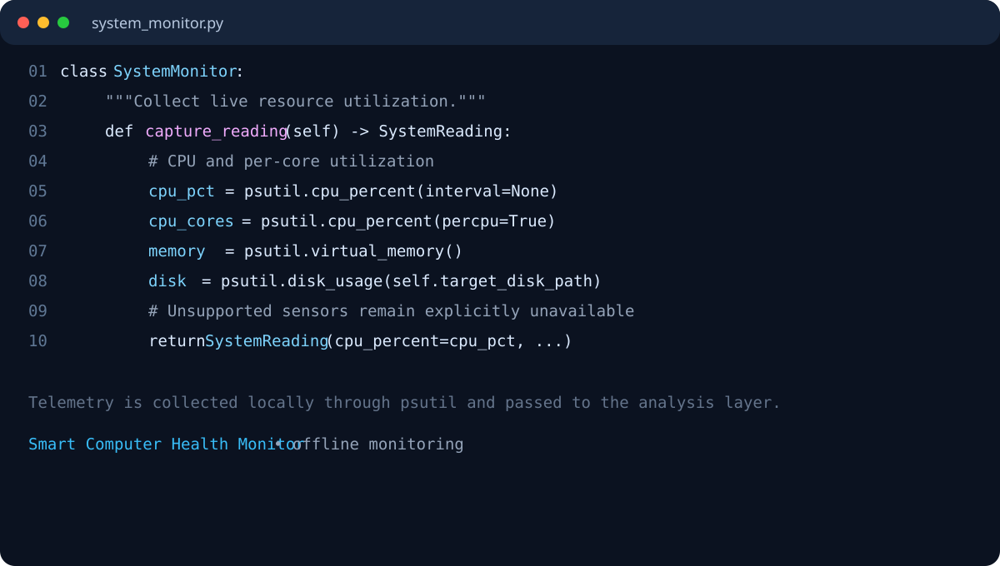
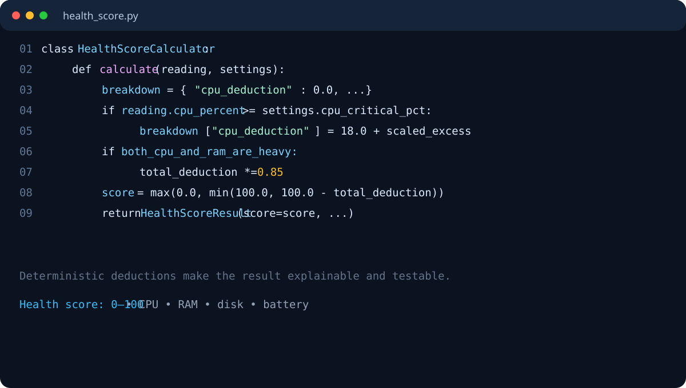
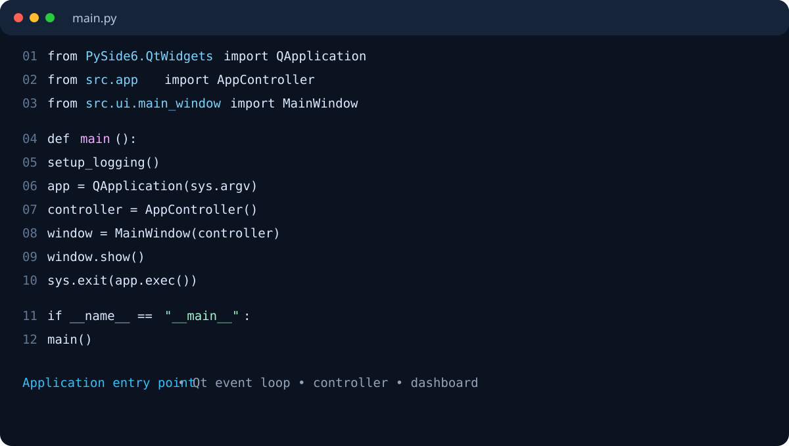

# Review 9 Submission

## Smart Computer Health Monitor

**Student:** Ajay  
**Course / Subject:** Operating Systems  
**Review:** 9  
**Submission contents:** Presentation, GitHub repository link, and code screenshots

---

## 1. Project Summary

Smart Computer Health Monitor is an offline desktop application that collects live operating-system telemetry and converts it into understandable health insights. Instead of only showing raw percentages, it explains which resource is under pressure, provides supporting evidence, calculates a transparent health score, and suggests safe corrective actions.

The application monitors:

- CPU utilization and per-core activity
- RAM usage and availability
- Disk capacity and disk I/O rates
- Battery state when a battery sensor is available
- Top processes and their resource consumption

The desktop interface is built with PySide6. Telemetry is collected through `psutil`, stored locally in SQLite, analyzed by deterministic Python modules, and exported as CSV/PDF reports.

## 2. GitHub Repository

> **Action required before submission:** Replace the placeholder below with the public GitHub repository URL.

**GitHub link:** `[Paste GitHub repository link here]`

Suggested format:

```text
https://github.com/<username>/Smart-Computer-Health-Monitor
```

**Presentation:** [`Smart_Computer_Health_Monitor.pptx`](../Smart_Computer_Health_Monitor.pptx)

## 3. Main Contribution

The core contribution is the **Interpretation Layer**:

```text
OS telemetry -> threshold rules -> evidence-based interpretation
              -> health score -> alerts -> recommendations -> dashboard
```

It prevents a high reading from being treated as an automatic failure. For example, high CPU use may be a legitimate workload, so the application considers sustained evidence, resource combinations, and top processes before producing an insight.

## 4. Technologies Used

| Area | Technology |
|---|---|
| Language | Python 3.11+ |
| Desktop UI | PySide6 / Qt6 |
| System telemetry | psutil |
| Local database | SQLite3 |
| Charts | Matplotlib / Qt painting components |
| Reports | ReportLab and CSV |
| Testing | pytest |
| Privacy model | 100% local/offline processing |

## 5. Important Files

| File | Purpose |
|---|---|
| `main.py` | Starts the Qt application and logging |
| `src/monitoring/system_monitor.py` | Captures CPU, RAM, disk, I/O, and battery data |
| `src/analysis/health_score.py` | Calculates the explainable 0–100 health score |
| `src/analysis/interpretation_engine.py` | Converts sustained measurements into insights |
| `src/analysis/recommendation_engine.py` | Produces safe advisory recommendations |
| `src/alerts/alert_manager.py` | Handles alert deduplication and lifecycle |
| `src/database/db_manager.py` | Persists metrics, processes, insights, and settings |
| `src/reports/report_exporter.py` | Exports CSV and PDF reports |
| `src/ui/main_window.py` | Builds the desktop dashboard |

## 6. Code Evidence

### Screenshot 1: System monitoring



Source: [`src/monitoring/system_monitor.py`](../src/monitoring/system_monitor.py)

### Screenshot 2: Explainable health score



Source: [`src/analysis/health_score.py`](../src/analysis/health_score.py)

### Screenshot 3: Application entry point



Source: [`main.py`](../main.py)

## 7. Demonstration Flow

1. Start the application with `python main.py`.
2. Open the Overview page to view CPU, RAM, disk, battery, and health score cards.
3. Open Process Explorer to inspect active processes.
4. Open Health Insights to see evidence-based explanations.
5. Open Recommendations to view safe next steps.
6. Open History to inspect resource trends.
7. Export a CSV or PDF report from the Reports/History workflow.

## 8. Verification

Run the automated tests from the project root:

```powershell
python -m pytest -v
```

The repository includes tests for:

- Health-score boundaries and deductions
- Sustained versus transient CPU conditions
- RAM, disk, and combined-resource insights
- Alert suppression, escalation, acknowledgement, and recovery
- Database CRUD and settings persistence
- Process inspection when a process disappears
- Recommendation mapping
- CSV/PDF report generation

## 9. Review 9 Submission Checklist

- [ ] Update the GitHub URL in this document.
- [ ] Push the complete project to GitHub.
- [ ] Include `README.md`, source code, tests, and `requirements.txt`.
- [ ] Attach `Smart_Computer_Health_Monitor.pptx`.
- [ ] Include the three code screenshots from `docs/code-screenshots/`.
- [ ] Run `python -m pytest -v` and capture the passing result.
- [ ] Confirm that no passwords, API keys, or private data are committed.
